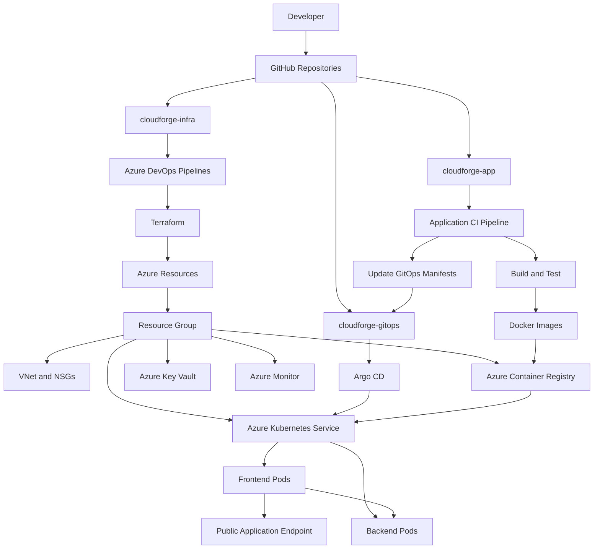
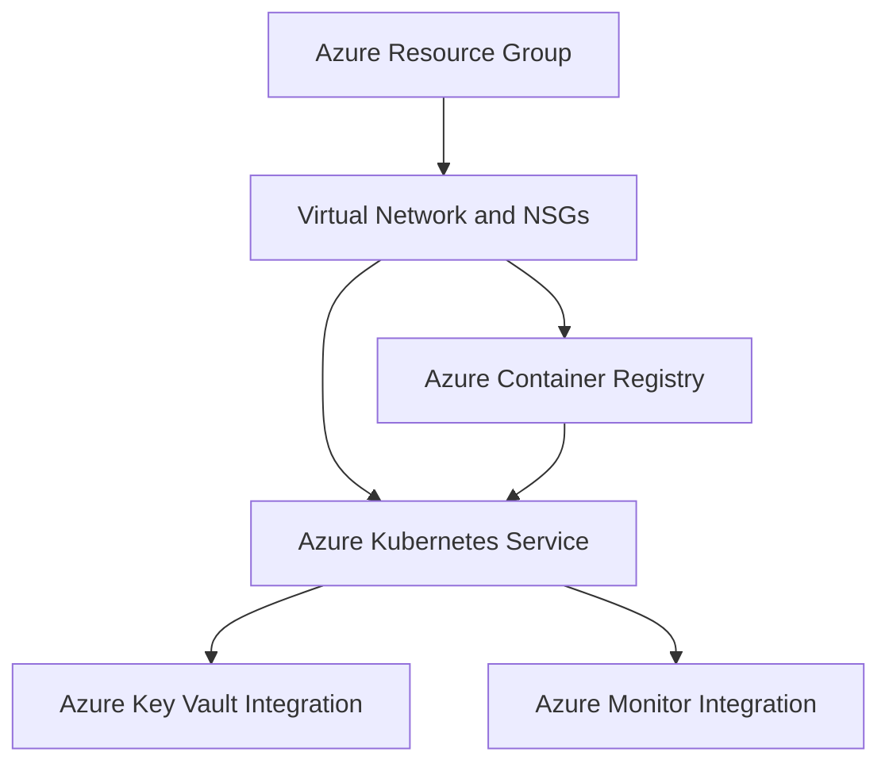
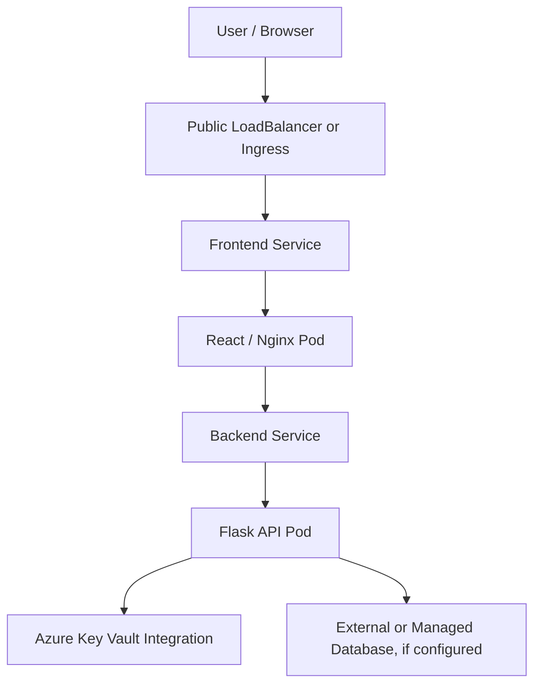
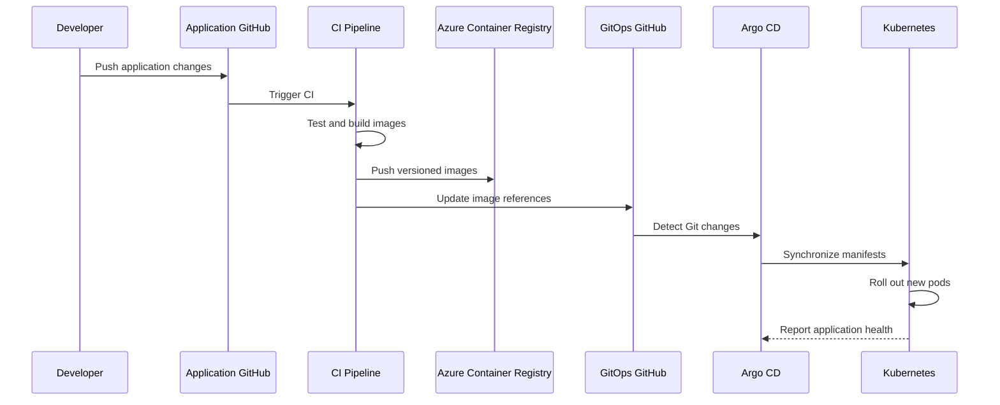
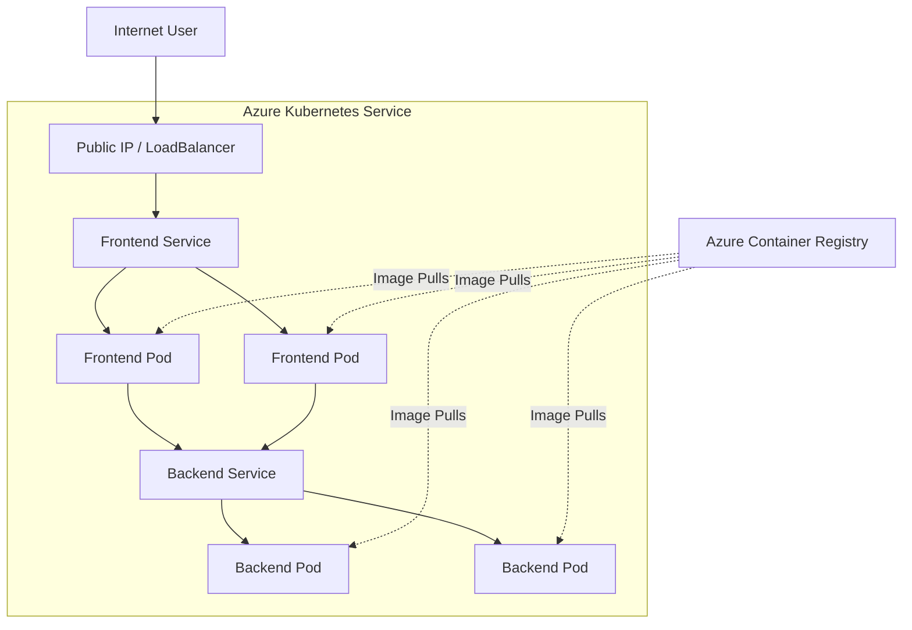

# ☁️ CloudForge — Azure Cloud Infrastructure & GitOps Platform

**Cloud Infrastructure as Code | Kubernetes | CI/CD | GitOps | DevOps Automation**

CloudForge is a cloud-native DevOps project designed to provision, deploy, and manage a containerized full-stack application on Microsoft Azure. It combines Terraform-based infrastructure provisioning, Docker containerization, Azure Kubernetes Service (AKS), Azure Container Registry (ACR), Azure DevOps pipelines, and Argo CD GitOps delivery.

The project follows a modular, environment-based architecture to make infrastructure reproducible, application deployments consistent, and cloud resources easier to maintain.

---

## 📌 Table of Contents

- [Project Overview](#-project-overview)
- [Objectives](#-objectives)
- [Technology Stack](#-technology-stack)
- [System Architecture](#-system-architecture)
- [Repository Structure](#-repository-structure)
- [Infrastructure Provisioning](#-infrastructure-provisioning)
- [Application Architecture](#-application-architecture)
- [CI/CD and GitOps Workflow](#-cicd-and-gitops-workflow)
- [Deployment Roadmap](#-deployment-roadmap)
- [Kubernetes Architecture](#-kubernetes-architecture)
- [Troubleshooting Guide](#-troubleshooting-guide)
- [Security Practices](#-security-practices)
- [Future Enhancements](#-future-enhancements)

---

## 🚀 Project Overview

CloudForge automates the lifecycle of a full-stack application running on Azure.

The platform consists of three primary components:

1. **Infrastructure Repository (`cloudforge-infra`)** — Provisions Azure infrastructure using reusable Terraform modules.
2. **Application Repository (`cloudforge-app`)** — Contains the frontend and backend application code, Dockerfiles, and local development configuration.
3. **GitOps Repository (`cloudforge-gitops`)** — Stores Kubernetes manifests and Argo CD configuration for declarative application deployment.

These repositories separate infrastructure management, application development, and deployment configuration.

### Key capabilities

- Infrastructure provisioning using Terraform.
- Container image creation using Docker.
- Centralized image storage in Azure Container Registry.
- Container orchestration with Azure Kubernetes Service.
- CI/CD automation using Azure DevOps.
- Declarative application deployment through Argo CD.
- Secret management using Azure Key Vault.
- Infrastructure and application monitoring through Azure Monitor.

---

## 🎯 Objectives

- Build a production-oriented Azure infrastructure using Infrastructure as Code.
- Implement reusable Terraform modules and environment-specific configurations.
- Containerize frontend and backend services.
- Deploy and manage applications on Azure Kubernetes Service.
- Automate infrastructure validation and deployment through CI/CD pipelines.
- Implement GitOps-based continuous delivery using Argo CD.
- Integrate secure secret management and cloud monitoring.
- Understand Kubernetes networking, service discovery, ingress, and external access.
- Establish a repeatable workflow for development and production environments.

---

## 🛠️ Technology Stack

| Technology | Purpose |
|---|---|
| Microsoft Azure | Cloud infrastructure and managed services |
| Terraform | Infrastructure as Code (IaC) |
| Docker | Application containerization |
| Kubernetes | Container orchestration |
| Azure Kubernetes Service (AKS) | Managed Kubernetes cluster |
| Azure Container Registry (ACR) | Container image registry |
| GitHub | Source control and GitOps repositories |
| Azure DevOps | CI/CD pipelines and Terraform automation |
| Argo CD | GitOps-based continuous delivery |
| Azure Key Vault | Secrets, keys, and certificates management |
| Azure Virtual Network (VNet) | Private network infrastructure |
| Network Security Groups (NSGs) | Network traffic filtering |
| Azure Monitor | Infrastructure metrics, logs, and observability |
| React | Frontend application |
| Nginx | Frontend static-file serving |
| Python / Flask | Backend REST API |
| Kubernetes Services | Internal communication and application exposure |
| Kubernetes ConfigMaps | Non-sensitive application configuration |
| Azure Workload Identity | Secure workload access to Azure resources, when configured |
| Secrets Store CSI Driver | Mounting Key Vault secrets into Kubernetes pods, when configured |

---

## 🏛️ System Architecture



**Architecture principle:** Terraform manages Azure infrastructure, Docker packages the application, Kubernetes runs the workloads, and Argo CD reconciles the cluster with the desired configuration stored in Git.

The CI pipeline and GitOps repository coordinate application releases, while infrastructure changes follow a separate Terraform workflow.

---

## 📂 Repository Structure

CloudForge is organized into three repositories.

### 1. Infrastructure Repository — `cloudforge-infra`

Responsible for provisioning and managing Azure resources.

```text
cloudforge-infra/
│
├── terraform/
│   ├── modules/
│   │   ├── resource-group/
│   │   │   ├── main.tf
│   │   │   ├── variables.tf
│   │   │   └── outputs.tf
│   │   │
│   │   ├── networking/
│   │   │   ├── main.tf
│   │   │   ├── variables.tf
│   │   │   └── outputs.tf
│   │   │
│   │   ├── acr/
│   │   │   ├── main.tf
│   │   │   ├── variables.tf
│   │   │   └── outputs.tf
│   │   │
│   │   ├── aks/
│   │   │   ├── main.tf
│   │   │   ├── variables.tf
│   │   │   └── outputs.tf
│   │   │
│   │   ├── key-vault/
│   │   │   ├── main.tf
│   │   │   ├── variables.tf
│   │   │   └── outputs.tf
│   │   │
│   │   └── monitoring/
│   │       ├── main.tf
│   │       ├── variables.tf
│   │       └── outputs.tf
│   │
│   └── environments/
│       ├── dev/
│       │   ├── main.tf
│       │   ├── variables.tf
│       │   ├── outputs.tf
│       │   ├── providers.tf
│       │   ├── backend.tf
│       │   └── terraform.tfvars
│       │
│       └── prod/
│           ├── main.tf
│           ├── variables.tf
│           ├── outputs.tf
│           ├── providers.tf
│           ├── backend.tf
│           └── terraform.tfvars
│
├── pipelines/
│   ├── terraform-plan.yml
│   └── terraform-apply.yml
│
├── azure-pipelines.yml
├── .gitignore
└── README.md
```

**Responsibilities**

- `modules/`: Reusable Terraform modules for individual Azure resources.
- `environments/dev/`: Development environment configuration.
- `environments/prod/`: Production environment configuration.
- `pipelines/terraform-plan.yml`: Infrastructure validation and plan workflow.
- `pipelines/terraform-apply.yml`: Infrastructure deployment workflow.
- `backend.tf`: Terraform state backend configuration.

> Production resources should use separate state, restricted permissions, and reviewed deployment plans.

### 2. Application Repository — `cloudforge-app`

Responsible for application development, testing, containerization, and application CI.

```text
cloudforge-app/
│
├── backend/
│   ├── src/
│   ├── tests/
│   ├── requirements.txt
│   └── Dockerfile
│
├── frontend/
│   ├── src/
│   ├── package.json
│   └── Dockerfile
│
├── .github/
│   └── workflows/
│
├── docker-compose.yml
├── .gitignore
└── README.md
```

**Frontend**

- React-based user interface.
- Containerized and served through Nginx.
- Exposed through a Kubernetes Service and the application's external entry point.

**Backend**

- Python Flask REST API.
- Runs on port `5000`.
- Containerized using Docker.
- Exposed internally through a Kubernetes Service.

**Local development**

Docker Compose is used to run the frontend and backend together during development.

### 3. GitOps Repository — `cloudforge-gitops`

Responsible for declarative Kubernetes configuration and Argo CD deployment management.

```text
cloudforge-gitops/
│
├── apps/
│   └── cloudforge/
│       ├── namespace.yaml
│       ├── frontend/
│       │   ├── deployment.yaml
│       │   └── service.yaml
│       ├── backend/
│       │   ├── deployment.yaml
│       │   ├── service.yaml
│       │   ├── serviceaccount.yaml
│       │   └── secretproviderclass.yaml
│       ├── configmap.yaml
│       └── ingress.yaml
│
├── argocd/
│   ├── application.yaml
│   └── project.yaml
│
├── environments/
│   ├── dev/
│   │   └── kustomization.yaml
│   └── prod/
│       └── kustomization.yaml
│
├── README.md
└── .gitignore
```

**Responsibilities**

- Store Kubernetes Deployments, Services, and application configuration.
- Define namespace and environment-specific settings.
- Configure Argo CD Applications and Projects.
- Manage image versions and deployment configuration through Git.
- Integrate Key Vault secret delivery when the relevant Azure identity and CSI components are configured.
- Maintain separate development and production overlays.

---

## 🏗️ Infrastructure Provisioning

Terraform provisions the Azure resources required to run CloudForge.

### Infrastructure dependency flow



### Provisioning stages

| Stage | Component | Purpose | Status |
|---|---|---|---|
| 1 | Resource Group | Organize Azure resources | Completed |
| 2 | Networking | VNet and network security configuration | Completed |
| 3 | ACR | Store frontend and backend images | Completed |
| 4 | AKS | Managed Kubernetes cluster | Next |
| 5 | Key Vault | Secure application secret management | Planned |
| 6 | Monitoring | Metrics, logs, and observability | Planned |

*Status reflects the project progress recorded when this README was prepared. Update it as implementation progresses.*

### Terraform workflow

Run these commands from the appropriate environment directory.

```powershell
cd terraform/environments/dev

terraform init

terraform fmt -recursive

terraform validate

terraform plan -out=tfplan

terraform apply tfplan
```

For production, use a reviewed plan and a separate state backend and access policy.

**Important:** `terraform apply` creates or changes real Azure resources and may incur charges. Verify the plan and resource configuration before applying.

---

## 🐳 Application Architecture

CloudForge uses a two-tier application architecture consisting of a frontend and backend.



### Frontend

| Property | Configuration |
|---|---|
| Technology | React |
| Web server | Nginx |
| Container port | `80` |
| Kubernetes workload | Deployment |
| Kubernetes networking | Service |
| External access | LoadBalancer or Ingress, depending on configuration |

### Backend

| Property | Configuration |
|---|---|
| Technology | Python / Flask |
| Container port | `5000` |
| Kubernetes workload | Deployment |
| Kubernetes networking | ClusterIP Service |
| Secrets | Azure Key Vault integration, when configured |

The frontend communicates with the backend through its configured API endpoint. In-cluster communication should use Kubernetes Service DNS rather than pod IP addresses.

For a frontend running in a user's browser, configure a browser-accessible API URL. A Kubernetes-only hostname such as `cloudforge-backend-service` cannot normally be resolved by the user's browser.

---

## 🔄 CI/CD and GitOps Workflow

CloudForge separates infrastructure automation from application delivery.

### Infrastructure pipeline

1. A developer pushes Terraform changes to `cloudforge-infra`.
2. Azure DevOps triggers the infrastructure pipeline.
3. Terraform formatting and validation checks run.
4. Terraform generates an execution plan.
5. The plan is reviewed and approved where required.
6. The pipeline applies the approved infrastructure changes.

### Application CI pipeline

1. A developer pushes application code to `cloudforge-app`.
2. The CI pipeline runs frontend and backend checks.
3. Docker builds the application images.
4. The images are tagged with a release version or commit SHA.
5. The images are pushed to Azure Container Registry.
6. The pipeline updates the corresponding image references in `cloudforge-gitops`.

### GitOps delivery pipeline

1. The updated Kubernetes manifests are committed to `cloudforge-gitops`.
2. Argo CD detects the repository change.
3. Argo CD compares the desired configuration with the live cluster.
4. Argo CD synchronizes the application when configured to do so.
5. Kubernetes performs the rollout.
6. Deployment health, pod status, and application connectivity are verified.



> **GitOps rule:** Git is the source of truth for the desired application configuration. Avoid making persistent manual changes directly to live resources because Argo CD may reconcile them back to the Git-defined state.

---

## ☸️ Kubernetes Architecture

The application runs on AKS using separate frontend and backend workloads.



The diagram illustrates the intended scalable architecture. Actual replica counts depend on the deployed manifests.

### Kubernetes resources

| Resource | Responsibility |
|---|---|
| Namespace | Isolate CloudForge application resources |
| Deployment | Maintain the desired number of application replicas |
| Pod | Run the application container |
| Service | Provide stable networking and service discovery |
| ConfigMap | Store non-sensitive configuration |
| ServiceAccount | Provide a workload identity association where configured |
| SecretProviderClass | Configure Key Vault secret retrieval through the CSI driver |
| Ingress | Route HTTP/HTTPS traffic when an ingress controller is installed |
| LoadBalancer | Expose a Kubernetes Service externally |

### Deployment verification

After applying or synchronizing the manifests:

```powershell
kubectl get namespaces

kubectl get deployments -n cloudforge

kubectl get pods -n cloudforge -o wide

kubectl get services -n cloudforge

kubectl get ingress -n cloudforge

kubectl rollout status deployment/cloudforge-frontend -n cloudforge

kubectl rollout status deployment/cloudforge-backend -n cloudforge
```

Use the actual namespace and deployment names from the manifests if they differ.

---

## 🌐 Application Connectivity and Troubleshooting

When the application is deployed but inaccessible, follow this diagnostic sequence:

**Check the Pod → Check the Service → Check the External IP → Test Connectivity → Inspect Azure Networking.**

### Step 1: Check pod status

```powershell
kubectl get pods -n cloudforge -o wide

kubectl describe pod <pod-name> -n cloudforge

kubectl logs deployment/cloudforge-frontend -n cloudforge

kubectl logs deployment/cloudforge-backend -n cloudforge
```

Look for `ImagePullBackOff`, `ErrImagePull`, `CrashLoopBackOff`, failed readiness probes, and application errors.

### Step 2: Check the Service

```powershell
kubectl get services -n cloudforge

kubectl describe service <service-name> -n cloudforge

kubectl get endpoints <service-name> -n cloudforge
```

Verify that the Service selector matches the pod labels and that the target port points to the correct container port.

If the Service has no endpoints, investigate its selectors and the readiness of the matching pods.

### Step 3: Check the external IP

```powershell
kubectl get services -n cloudforge -w

kubectl get ingress -n cloudforge
```

For a `LoadBalancer` Service, inspect the `EXTERNAL-IP` field. Azure may need time to provision the associated public IP and load-balancing resources.

An Ingress resource alone does not expose the application: an appropriate ingress controller and its networking configuration must also exist.

### Step 4: Test connectivity

From PowerShell, test the actual public endpoint:

```powershell
curl.exe -v http://<EXTERNAL-IP>/
```

For an HTTPS endpoint:

```powershell
curl.exe -v https://<APPLICATION-DOMAIN>/
```

Check the browser's developer console and network tab for frontend errors, incorrect API URLs, failed requests, or CORS issues.

To test the backend internally:

```powershell
kubectl port-forward service/cloudforge-backend-service 5000:5000 -n cloudforge
```

In a separate terminal:

```powershell
curl.exe -v http://127.0.0.1:5000/
```

Replace the Service name or endpoint path if your configuration differs.

### Step 5: Inspect Azure networking

If Kubernetes resources look healthy but the public endpoint fails, inspect:

- Azure Load Balancer and Public IP resources.
- VNet, subnet, route tables, and NSG rules.
- AKS network configuration.
- DNS records and TLS configuration.
- Application listening addresses and container ports.
- Health probes and frontend-to-backend connectivity.

For detailed Kubernetes events:

```powershell
kubectl get events -n cloudforge --sort-by=.metadata.creationTimestamp
```

For AKS cluster information:

```powershell
az aks show `
  --resource-group cloudforge-dev-rg `
  --name <aks-cluster-name> `
  --output table
```

Use the actual resource group and cluster name from your Azure configuration.

---

## 🔐 Security Practices

CloudForge is designed around secure infrastructure and deployment practices.

- Store Terraform state in a secured remote backend with access controls and locking support.
- Never commit credentials, API keys, Terraform state files, or sensitive variable values to Git.
- Use Azure Key Vault for application secrets and certificates.
- Configure Azure RBAC and managed identities or workload identity instead of hardcoded Azure credentials.
- Use ACR authentication through AKS identity and the appropriate role assignments.
- Restrict NSG rules to the required sources, destinations, and ports.
- Avoid exposing the backend directly to the public internet unless necessary.
- Use HTTPS and appropriate TLS certificate management for public traffic.
- Pin container images to explicit versions or immutable digests instead of relying on `latest`.
- Use separate identities, permissions, state, and approval requirements for development and production.
- Review Terraform plans before applying infrastructure changes.

---

## 📈 Deployment Roadmap

### Phase 1 — Infrastructure Foundation

- [x] Create Azure Resource Group.
- [x] Configure Azure networking.
- [x] Provision Azure Container Registry.
- [ ] Provision Azure Kubernetes Service.
- [ ] Configure AKS-to-ACR image pull permissions.
- [ ] Validate cluster connectivity.

### Phase 2 — Application Deployment

- [ ] Build and publish frontend and backend images.
- [ ] Deploy frontend and backend workloads to AKS.
- [ ] Configure Kubernetes Services.
- [ ] Verify pod health and internal service communication.
- [ ] Expose the frontend using a public LoadBalancer or Ingress.
- [ ] Validate the external endpoint and browser-to-backend connectivity.

### Phase 3 — GitOps

- [ ] Configure Argo CD on the cluster.
- [ ] Connect Argo CD to the GitOps repository.
- [ ] Register the CloudForge application.
- [ ] Configure development environment overlays.
- [ ] Validate automated synchronization and rolling updates.
- [ ] Test recovery by reverting a GitOps change.

### Phase 4 — Security and Observability

- [ ] Provision Azure Key Vault.
- [ ] Configure secure workload access.
- [ ] Integrate Key Vault with Kubernetes using the appropriate CSI components.
- [ ] Configure Azure Monitor and Container Insights.
- [ ] Review network access policies and role assignments.
- [ ] Configure production environment safeguards.

### Phase 5 — Production Readiness

- [ ] Configure resource requests, limits, and health probes.
- [ ] Configure HTTPS, DNS, and certificate management.
- [ ] Configure autoscaling where appropriate.
- [ ] Add pipeline approvals and image vulnerability scanning.
- [ ] Test rollback, disaster recovery, and infrastructure teardown procedures.
- [ ] Document deployment and incident-response procedures.

---

## 💻 Prerequisites

Install and configure the following tools before working on CloudForge:

- [Azure CLI](https://learn.microsoft.com/cli/azure/install-azure-cli)
- [Terraform](https://developer.hashicorp.com/terraform/install)
- [Docker Desktop](https://www.docker.com/products/docker-desktop/)
- [kubectl](https://kubernetes.io/docs/tasks/tools/)
- [Git](https://git-scm.com/downloads)
- An Azure subscription with appropriate resource permissions
- A GitHub account and an Azure DevOps organization
- An AKS cluster and Argo CD installation when working on GitOps deployment

Verify the local setup:

```powershell
az --version

terraform version

docker --version

docker compose version

kubectl version --client

git --version
```

Authenticate to Azure:

```powershell
az login

az account show
```

Select the intended subscription if necessary:

```powershell
az account set --subscription "<SUBSCRIPTION-ID>"
```

---

## 📚 Learning Outcomes

This project provides practical experience with:

- Azure cloud architecture and resource provisioning.
- Modular Terraform development and environment separation.
- Terraform state management and deployment planning.
- Docker image creation and registry management.
- Kubernetes workloads, Services, and networking.
- AKS cluster administration and ACR integration.
- Azure DevOps CI/CD automation.
- GitOps delivery using Argo CD.
- Azure Key Vault integration and workload identity.
- Infrastructure troubleshooting, monitoring, and deployment validation.

---

## 🔮 Future Enhancements

Potential improvements include:

- Helm charts for reusable Kubernetes deployments.
- Kustomize overlays for environment-specific configuration.
- Automated container security scanning.
- Policy-as-code and Terraform security checks.
- Azure Monitor dashboards and alert rules.
- Horizontal Pod Autoscaler and cluster autoscaling.
- TLS and custom domain automation.
- Progressive delivery using canary or blue-green deployments.
- Automated smoke tests after deployment.
- Backup, recovery, and cost-monitoring automation.

---

## 👨‍💻 Project Status

CloudForge is being developed incrementally, starting with the Azure infrastructure foundation and progressing toward a complete Kubernetes and GitOps delivery platform.

**Current milestone:** Azure Resource Group, networking, and ACR are provisioned. AKS provisioning and application deployment are the next major steps.

**Primary Git branch:** `master`

**Project focus:** Infrastructure as Code, Azure, Kubernetes, DevOps automation, and GitOps.

---

## 📄 License

Add a `LICENSE` file to the repository if the project is intended to be distributed under an open-source license.

---

**CloudForge — Provision infrastructure with code. Deploy applications with confidence. Manage releases through GitOps.**
